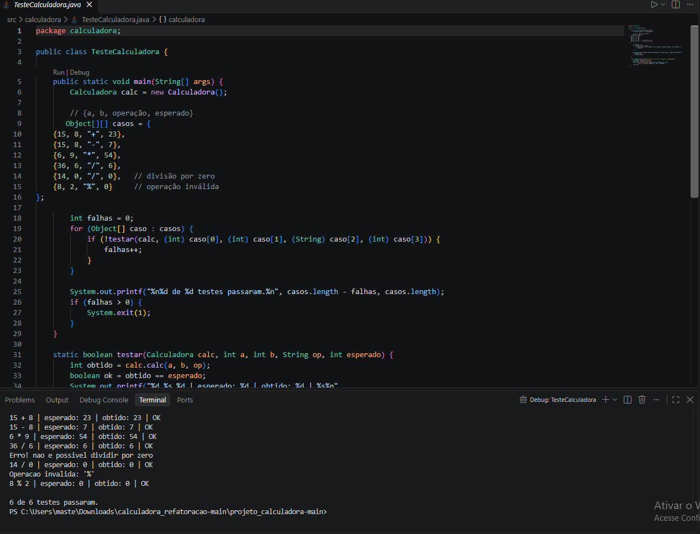

# Projeto Calculadora: FinançApp

> Projeto acadêmico com foco em Qualidade de Software, Testes, Refatoração, Documentação e Versionamento.

> Você está na branch **`main`**, que guarda a versão inicial do projeto, anterior à refatoração. A versão final, com JavaDoc e a pasta `docs/`, fica na branch **`Refatoracao`**.

---

## 1. Identificação do Projeto

**Projeto:** Projeto Calculadora  
**Contexto:** FinançApp  
**Aluno:** Enzo Müller Santana  
**RA:** 252314  
**Turma:** AS406TSN4  
**Curso:** Análise e Desenvolvimento de Sistemas 
**Disciplina:** UX/UI e Testes de Software (Turma AS406TSN4)
**Professor:** Daniel Ohata  
**Semestre:** 4º Semestre — 2026.2  

---

## 2. Visão Geral

O projeto é um módulo de cálculos matemáticos básicos em Java, criado para a startup fictícia **FinançApp**.

A ideia é que ele seja usado futuramente em funcionalidades de controle financeiro, como:

- orçamento mensal;
- divisão de despesas;
- projeções financeiras;
- cálculos auxiliares.

Além de calcular corretamente, o projeto aplica práticas de qualidade de software: testes, tratamento de erros, refatoração, documentação, versionamento e manutenção de código.

---

## 3. Problema

Durante o desenvolvimento do FinançApp, surgiu a necessidade de um módulo matemático reutilizável. A equipe definiu que ele não deveria apenas funcionar, mas também ter:

- código legível;
- testes;
- tratamento de falhas;
- documentação técnica;
- controle de versões;
- facilidade de manutenção.

O desafio é entregar uma solução funcional aplicando boas práticas de Engenharia de Software.

---

## 4. Objetivos

### 4.1 Objetivo Geral

Desenvolver uma calculadora em Java aplicando práticas de qualidade, testes, documentação, refatoração e versionamento.

### 4.2 Objetivos Técnicos

- implementar as operações matemáticas básicas;
- tratar entradas inválidas;
- impedir a divisão por zero;
- desenvolver testes para as operações;
- refatorar o código sem alterar seu comportamento;
- documentar classes e métodos com JavaDoc;
- gerar a documentação em HTML;
- utilizar Git e GitHub;
- organizar commits e branches;
- manter a documentação técnica no README.

---

## 5. Escopo Funcional

O método `calc(int a, int b, String op)` recebe dois inteiros e um operador (`+`, `-`, `*` ou `/`) e retorna o resultado.

| ID | Funcionalidade | Descrição | Status |
|---|---|---|---|
| RF01 | Soma | Soma dois números inteiros | ✅ |
| RF02 | Subtração | Subtrai dois números inteiros | ✅ |
| RF03 | Multiplicação | Multiplica dois números inteiros | ✅ |
| RF04 | Divisão | Divide dois números inteiros | ✅ |
| RF05 | Validação de divisão | Impede divisão por zero | ✅ |
| RF06 | Operação inválida | Trata operadores não suportados | ✅ |

### Tratamento de erros

| Situação | Comportamento |
|---|---|
| Divisão por zero | Exibe mensagem de erro e retorna `0` |
| Operador inválido | Exibe mensagem de operação inválida e retorna `0` |
| Operador nulo | Exibe mensagem informando que nenhum operador foi passado e retorna `0` |

---

## 6. Requisitos Não Funcionais

| ID | Categoria | Requisito |
|---|---|---|
| RNF01 | Qualidade | O código deve ser organizado e legível |
| RNF02 | Testabilidade | As operações devem ter testes |
| RNF03 | Manutenção | O código deve permitir refatoração sem alteração funcional |
| RNF04 | Documentação | Classes e métodos devem ter JavaDoc |
| RNF05 | Versionamento | O projeto deve utilizar Git e GitHub |
| RNF06 | Confiabilidade | Erros não devem interromper inesperadamente a execução |

---

## 7. Tecnologias Utilizadas

| Tecnologia | Versão | Utilização |
|---|---|---|
| Java / JDK | 17 | Desenvolvimento e compilação |
| Git | _sua versão_ | Controle de versão |
| GitHub | — | Repositório remoto |
| JavaDoc | — | Documentação (branch `Refatoracao`) |
| Visual Studio Code | _sua versão_ | Ambiente de desenvolvimento |

---

## 8. Testes

A classe `TesteCalculadora` executa 6 casos de teste e exibe, para cada um, a entrada, o valor esperado, o valor obtido e o status (`OK` ou `FALHOU`). Ao final, mostra quantos testes passaram.

| Caso | Entrada | Esperado |
|---|---|---|
| Soma | `15 + 8` | `23` |
| Subtração | `15 - 8` | `7` |
| Multiplicação | `6 * 9` | `54` |
| Divisão | `36 / 6` | `6` |
| Divisão por zero | `14 / 0` | `0` |
| Operação inválida | `8 % 2` | `0` |



---

## 9. Como Executar

```bash
javac -d bin src/calculadora/*.java
java -cp bin calculadora.TesteCalculadora
```

---

## 10. Estrutura do Projeto

```text
projeto_calculadora/
│
├── src/
│   └── calculadora/
│       ├── Calculadora.java
│       └── TesteCalculadora.java
│
├── images/
│   └── testes_original.png
│
├── README.md
├── .gitignore
└── demais arquivos do projeto
```

> Na branch `Refatoracao`, a estrutura também inclui a pasta `docs/` (JavaDoc em HTML).

---

## 11. Repositório

_(https://github.com/MLLRZO/projeto_calculadora.git)_